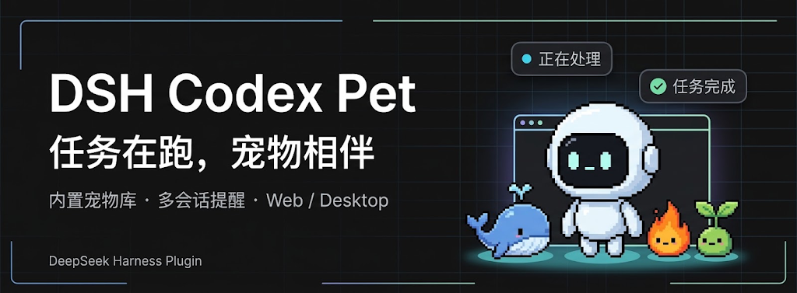
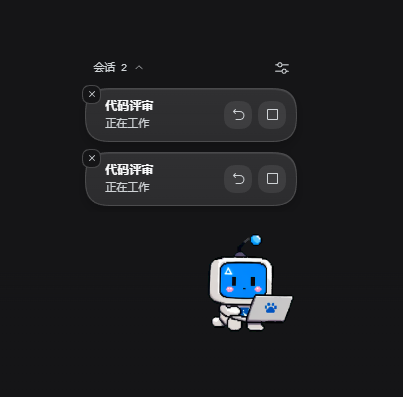
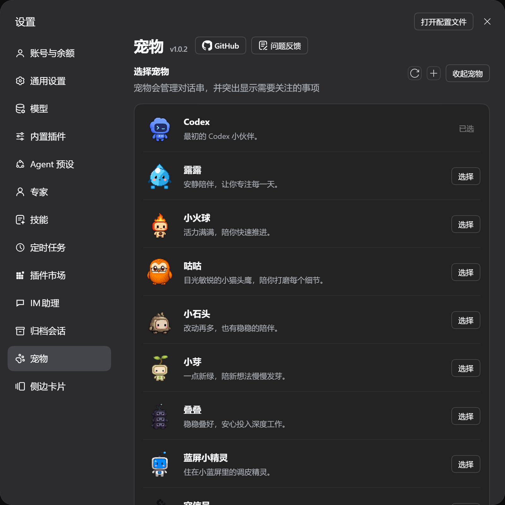
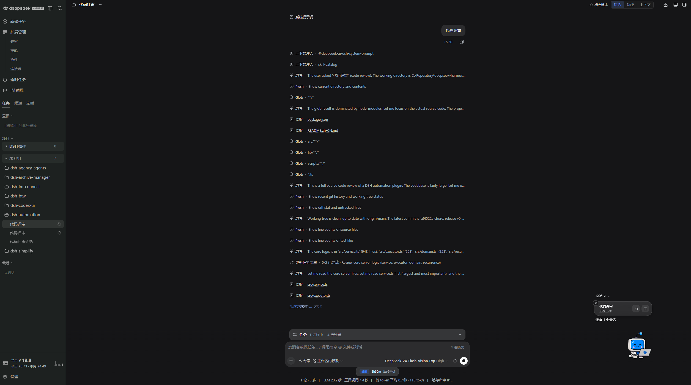

<p align="center">
  
</p>

<div align="center">

# DSH Codex Pet

**Um pequeno companheiro para as suas tarefas no DeepSeek Harness**

[简体中文](README.zh-CN.md) · [English](README.en.md) · [日本語](README.ja.md) · [Español](README.es.md) · [Français](README.fr.md) · [Deutsch](README.de.md) · [Русский](README.ru.md) · [Português](README.pt.md)

[Histórico de alterações](CHANGELOG.md) · [Apache-2.0](LICENSE)

[](LICENSE)
[](https://www.npmjs.com/package/@michengai/dsh-codex-pet)
[](https://www.npmjs.com/package/@michengai/dsh-codex-pet)
[](https://github.com/MichengAI/dsh-codex-pet)
[](https://nodejs.org/)

</div>

> O DSH Codex Pet é um plugin de mascote mantido pela comunidade para o DeepSeek Harness (DSH), não sendo um produto oficial da OpenAI ou da DeepSeek AI. A partir da versão 1.0.1, suporta o DSH `0.2.0-rc.1`, `0.2.0-rc.2`, `0.2.1-rc.1`–`0.2.1-rc.5` e `0.2.2-rc.1`. Versões anteriores e alfas do `0.2.1` são rejeitadas pela verificação de versão; as configurações locais e os mascotes personalizados não são removidos por isso.

## Funcionalidades

Mantenha um companheiro por perto enquanto trabalha no DSH, acompanhe o progresso das tarefas e gerencie as solicitações que precisam da sua atenção. Escolha entre 9 mascotes integrados ou crie o seu próprio usando um Skill.

- **9 mascotes integrados**: escolha um parceiro e ajuste o tamanho nas configurações. Os recursos visuais vêm empacotados localmente.
- **Companheiro na página**: acompanha seu trabalho no DSH Web.
- **Múltiplas tarefas num relance**: acompanhe tarefas em execução, concluídas, erros e solicitações pendentes. Sem notificações, apenas o mascote fica visível.
- **Ação a partir da notificação**: abra a tarefa correspondente, pare a rodada atual ou responda a aprovações de ferramentas, perguntas e planos suportados.
- **Silêncio quando precisar**: descarte um lembrete individual sem parar a tarefa; oculte ou restaure o mascote através do menu ou das configurações.
- **Crie o seu próprio mascote**: descreva o companheiro nas configurações e inicie uma tarefa dedicada no DSH usando o Skill `hatch-pet` incluído.
- **Interações leves**: arraste para mover, clique duplo para fazê-lo pular e clique com o botão direito para o menu.

## Capturas de tela

### Notificações de múltiplas tarefas

Veja as tarefas em execução ao lado do seu mascote, com controles individuais para abrir a conversa, parar a rodada ou descartar a notificação.

<p align="center">
  
</p>

### Configurações do mascote

Escolha entre os 9 mascotes integrados, acesse a pasta de mascotes personalizados e ajuste o tamanho de exibição.



### Um parceiro na sua conversa

Trabalhe no DSH enquanto o mascote e as notificações permanecem discretamente no canto da página.



## Ecossistema de produtos DSH

Para um ambiente de trabalho desktop completo, recomendamos o [DSH Codex Desktop](https://github.com/MichengAI/dsh-codex-desktop/releases). Instalações existentes do [DeepSeek Harness](https://github.com/deepseek-ai/deepseek-harness) podem adicionar plugins conforme a necessidade:

| Plugin | O que você pode fazer |
| --- | --- |
| [Codex UI](https://github.com/MichengAI/dsh-codex-ui) | Organizar projetos e conversas, buscar tarefas e navegar rapidamente pelo histórico |
| [Agency Agents](https://github.com/MichengAI/dsh-agency-agents) | Escolher e invocar agentes especialistas para suas tarefas |
| [Skills Manager](https://github.com/MichengAI/dsh-skills-manager) | Descobrir, habilitar, criar e importar habilidades locais |
| [Archive Manager](https://github.com/MichengAI/dsh-archive-manager) | Pesquisar, restaurar ou limpar conversas arquivadas |
| [IM Connect](https://github.com/MichengAI/dsh-im-connect) | Enviar tarefas e receber respostas através de plataformas de mensagens |
| [Automation](https://github.com/MichengAI/dsh-automation) | Agendar tarefas automatizadas e revisar o histórico de execuções |
| [BTW](https://github.com/MichengAI/dsh-btw) | Fazer perguntas pontuais sem interromper a sessão de trabalho principal |
| [Simplify](https://github.com/MichengAI/dsh-simplify) | Usar `/simplify` para aprimorar o código dentro das modificações do Git |
| [PUA](https://github.com/MichengAI/dsh-pua) | Orientar o agente a buscar novas alternativas após falhas e verificar os resultados |
| [Code Review](https://github.com/MichengAI/dsh-code-review) | Usar `/review` para solicitar uma revisão independente de código |
| [Codex Pet](https://github.com/MichengAI/dsh-codex-pet) | Acompanhar notificações de tarefas e responder a aprovações de ferramentas através do mascote |

## Instalação

Versões suportadas do DeepSeek Harness: **`0.2.0-rc.1`**, **`0.2.0-rc.2`**, **`0.2.1-rc.1`–`0.2.1-rc.5`** e **`0.2.2-rc.1`**. Certifique-se de que o comando `dsh` está disponível:

```powershell
[Console]::OutputEncoding = [System.Text.Encoding]::UTF8
$OutputEncoding = [System.Text.Encoding]::UTF8

dsh plugin --profile web add @michengai/dsh-codex-pet@latest --registry=https://registry.npmjs.org/ --ignore-scripts
```

Reinicie o DSH após a instalação e abra **Configurações → Mascotes** (ou **Settings → Pets**).

## Utilização

Abra **Configurações → Mascotes** ou use o botão direito do mouse sobre o mascote.

| Objetivo | Ação |
| --- | --- |
| Escolher parceiro | Selecione um mascote nas configurações e ajuste o tamanho. |
| Mover ou brincar | Arraste para mover; clique duplo para pular. |
| Ler atualizações | Observe as bolhas de notificação; expanda a lista se houver várias tarefas. |
| Abrir conversa | Clique na notificação para acessar a tarefa correspondente no DSH. |
| Atender solicitação | Abra os detalhes e responda à aprovação de ferramenta ou pergunta. |
| Interromper rodada | Clique no botão de parada na notificação da tarefa ativa. |
| Fechar lembrete | Clique no botão fechar (a tarefa continuará em execução). |
| Ocultar / restaurar | Use o menu de clique direito ou o painel de configurações. |

### Criar um mascote personalizado

1. Abra as configurações, clique no ícone **+** (`Criar`) e descreva o seu mascote.
2. Clique em **Criar no DSH** — uma conversa dedicada será aberta com as instruções do Skill.
3. Acompanhe o progresso (requer uma ferramenta de geração de imagens configurada no DSH).
4. Quando os arquivos forem salvos, atualize a biblioteca e selecione o novo companheiro.

## Atualização e desinstalação

Para atualizar:

```powershell
[Console]::OutputEncoding = [System.Text.Encoding]::UTF8
$OutputEncoding = [System.Text.Encoding]::UTF8

dsh plugin --profile web add @michengai/dsh-codex-pet@latest --registry=https://registry.npmjs.org/ --ignore-scripts
```

Para desinstalar:

```powershell
[Console]::OutputEncoding = [System.Text.Encoding]::UTF8
$OutputEncoding = [System.Text.Encoding]::UTF8

dsh plugin --profile web remove @michengai/dsh-codex-pet
```

Os mascotes personalizados ficam salvos em `.dsh/codex-pet/pets` no diretório do seu usuário. A desinstalação mantém esses arquivos e preferências salvos.

## Contribuir

Consulte o [guia de desenvolvimento e validação (em chinês)](https://github.com/MichengAI/dsh-codex-pet/blob/main/CONTRIBUTING.md) para conhecer os procedimentos de desenvolvimento local, testes e publicação. O GitHub e o npm incluem a pasta `lib` pronta para execução; após modificar o código-fonte, execute `npm run build` antes de realizar o commit.

## Licença

O código-fonte original deste plugin está sob a licença [Apache License 2.0](LICENSE). As artes em pixel-art dos mascotes foram originadas no OpenAI Codex e estão excluídas da concessão de licença Apache-2.0 deste projeto; veja [NOTICE](NOTICE).
